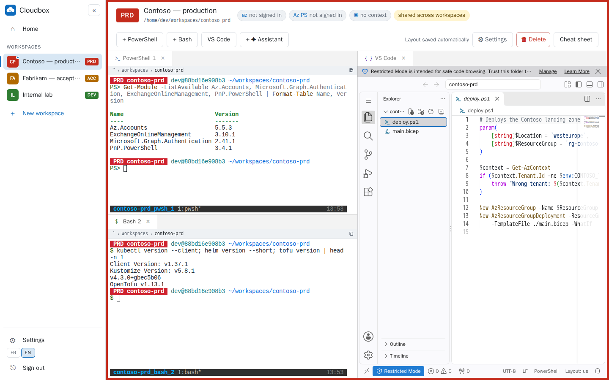
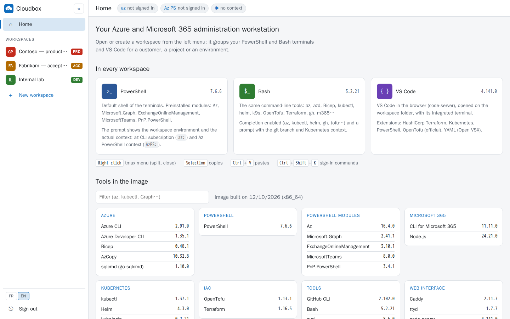
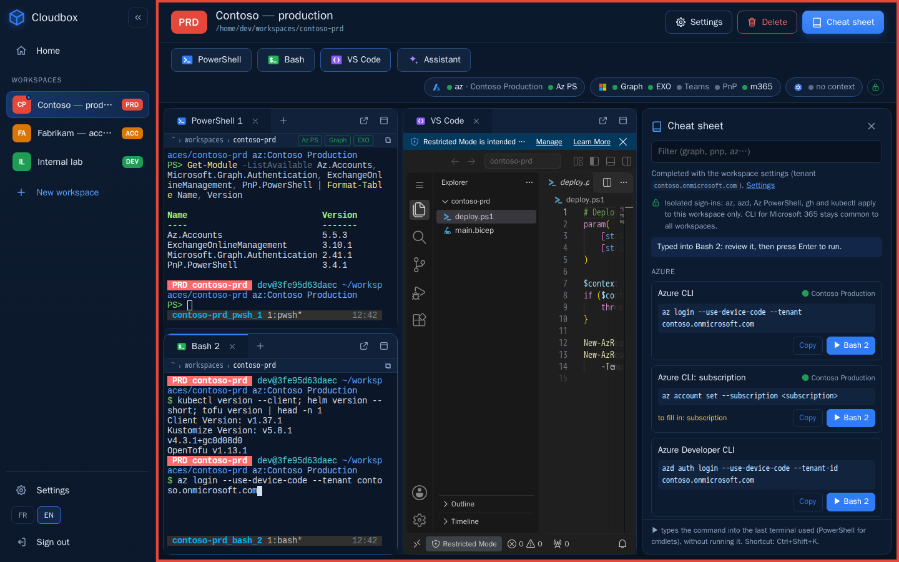
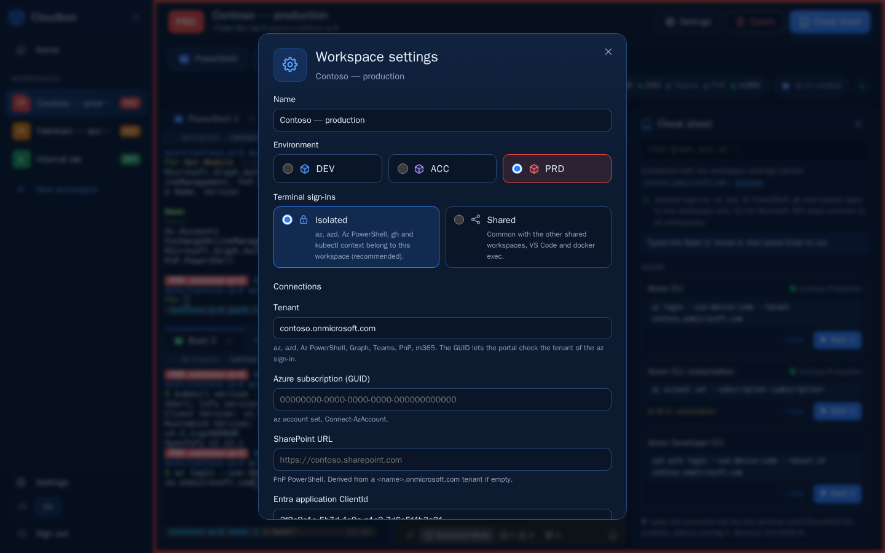
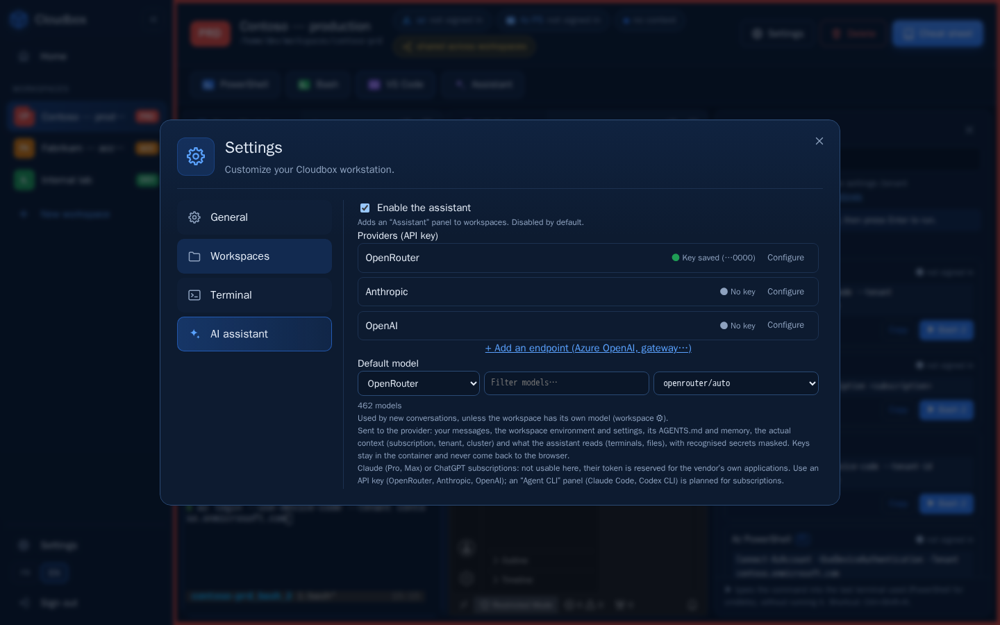
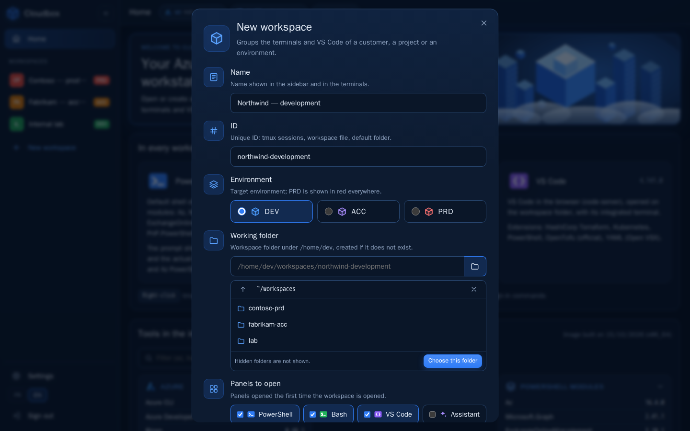
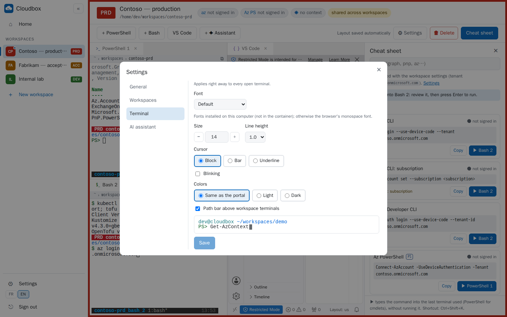
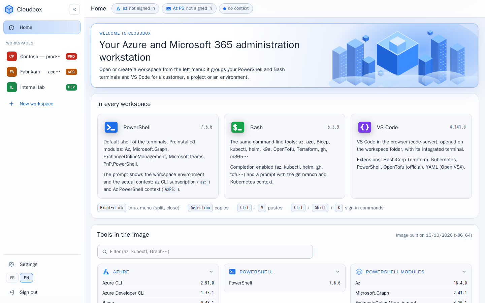

# Cloudbox

A **local Cloud Shell for Azure and Microsoft 365**: a Docker container that runs on your own PC
and is used from the browser, with a web terminal (PowerShell and Bash), VS Code in the browser,
a **dedicated AI assistant** and every Azure / Microsoft 365 administration tool, kept up to date.
The assistant helps with every task of an administration session (optional, bring your own API
key; see [AI assistant](#ai-assistant-optional)).

> **Status: step 2 (workspaces).** The `:cli` and `:web` images build and pass their tests
> (HTTP and browser). The technical framing and the roadmap are in [`CLAUDE.md`](CLAUDE.md)
> (in French)..



**Try it now**, nothing to build: see [Run the prebuilt image](#run-the-prebuilt-image-no-build-needed).

```bash
docker run -d --name cloudbox -p 127.0.0.1:8080:8080 -v cloudbox-home:/home/dev ghcr.io/ictdevops/cloudbox:web
docker logs cloudbox   # access token, then open http://localhost:8080
```

## Screenshots

| | |
|---|---|
|  |  |
| **Home**: the three tools of every workspace, terminal tips and the version of each tool in the image. | **Cheat sheet**: device-code sign-in commands completed with the workspace settings, typed into a terminal without being run. |
|  |  |
| **Workspace settings**: name, environment (DEV / ACC / PRD), tenant, subscription, SharePoint URL, ClientId. | **Settings**: language, theme, panels of new workspaces, and the AI assistant (API keys, default model). |
|  |  |
| **New workspace**: name, ID, environment, working folder (typed or picked among the folders of `/home/dev`) and the panels to open. | **Terminal appearance**: font, size, line height, cursor, colours, path bar. Applied right away to every open terminal. |
|  | |
| **Light theme**: the screenshots above use the dark theme. The theme follows the system setting or is chosen in Settings; the interface is available in English and French. | |

The screenshots are produced by [`docs/screenshots/capture.sh`](docs/screenshots/capture.sh)
(headless Chromium on a throwaway container with sample workspaces, dark theme except `home-light.png`).

## How it works

```
browser ──http://localhost:8080──▶ cloudbox container
                                     Caddy (token, Host/Origin checks)
                                     ├── /           portal and workspaces
                                     ├── /api/       cloudbox-api (workspaces, context)
                                     ├── /term/pwsh/ PowerShell terminal (ttyd + tmux)
                                     ├── /term/bash/ Bash terminal (ttyd + tmux)
                                     └── /code/      VS Code in the browser (code-server)
                                    /home/dev = persistent volume (sign-ins, keys, repos)
```

- **One container per person, on their own PC** (Docker Desktop, Podman or wslc).
  No central server.
- Reachable **from the PC only** (`127.0.0.1`), protected by a token.
- Classic terminal access still works: `docker exec -it cloudbox pwsh`.
- A **built-in AI assistant** works next to your terminals: it knows the workspace, reads what is
  actually signed in, and proposes the commands you approve.

## Run the prebuilt image (no build needed)

Cloudbox is published as a ready-to-use image on the GitHub Container Registry. Nothing has to be
cloned or built: reference the image and start it.

```
ghcr.io/ictdevops/cloudbox:web
```

- **Public**: no GitHub account and no `docker login` needed.
- **Platform**: linux/amd64 (Intel / AMD PCs: Windows with Docker Desktop, Linux). Macs with
  Apple Silicon can run it through Docker Desktop's x86-64 emulation, more slowly.
- **Size**: about 1.6 GB to download (every Azure and Microsoft 365 PowerShell module is
  included), so the first start takes a while.
- **Requirements**: Docker Desktop (Windows 11 with WSL2, macOS) or Docker Engine / Podman (Linux).

| Tag | When to use it |
|---|---|
| `:web` / `:latest` | Recommended: full image, latest release |
| `:edge` | Follows `main` commit by commit, including changes that do not touch the image |
| `:cli` | Tools only, no web interface (`docker exec`, wslc) |
| `:vYYYY.MM.DD-web` | A given release, to pin a version (see [Releases](https://github.com/ICTDevOps/cloudbox/releases)) |

> **Always publish the port on `127.0.0.1`**, as in the examples below. The web terminal holds
> your Azure and Microsoft 365 sign-ins: it must only be reachable from your own PC, never from
> the network. To use Cloudbox running on another machine, go through an SSH tunnel
> (`ssh -L 8080:localhost:8080 <host>`) or a private network such as Tailscale, not `0.0.0.0`.

### Option 1: `docker run`

```bash
docker run -d --name cloudbox --hostname cloudbox --restart unless-stopped \
  -p 127.0.0.1:8080:8080 \
  -v cloudbox-home:/home/dev \
  -e TZ=Europe/Paris \
  ghcr.io/ictdevops/cloudbox:web

docker logs cloudbox        # the access token is printed in a framed block
```

Windows PowerShell (line continuation with a backtick):

```powershell
docker run -d --name cloudbox --hostname cloudbox --restart unless-stopped `
  -p 127.0.0.1:8080:8080 `
  -v cloudbox-home:/home/dev `
  -e TZ=Europe/Paris `
  ghcr.io/ictdevops/cloudbox:web

docker logs cloudbox
```

Open **http://localhost:8080** and paste the token.

| Action | Command |
|---|---|
| Update | `docker pull ghcr.io/ictdevops/cloudbox:web`, then `docker rm -f cloudbox` and the `docker run` command again |
| Stop / start | `docker stop cloudbox` / `docker start cloudbox` |
| Shell without the browser | `docker exec -it cloudbox pwsh` or `docker exec -it cloudbox bash` |
| Remove (sign-ins and files are kept in the volume) | `docker rm -f cloudbox` |
| Remove everything | `docker rm -f cloudbox && docker volume rm cloudbox-home` |

### Option 2: Docker Compose

Create a folder with a `compose.yaml` file containing:

```yaml
name: cloudbox

services:
  cloudbox:
    image: ghcr.io/ictdevops/cloudbox:web
    container_name: cloudbox
    hostname: cloudbox
    restart: unless-stopped
    ports:
      - "127.0.0.1:8080:8080"     # never 0.0.0.0
    environment:
      TZ: Europe/Paris
      # CLOUDBOX_TOKEN: choose-a-token-of-16-characters-or-more   # otherwise generated
      # CLOUDBOX_SHELL: bash                                       # default: pwsh
      # CLOUDBOX_SUDO: "true"                                      # default: false
    volumes:
      - cloudbox-home:/home/dev

volumes:
  cloudbox-home:
    name: cloudbox-home
```

Or download the one from this repository, which reads its settings from a `.env` file
(see [Settings](#settings)):

```bash
curl -fsSLO https://raw.githubusercontent.com/ICTDevOps/cloudbox/main/compose.yaml
```

```powershell
Invoke-WebRequest https://raw.githubusercontent.com/ICTDevOps/cloudbox/main/compose.yaml -OutFile compose.yaml
```

Then, in that folder:

```bash
docker compose up -d
docker compose logs cloudbox        # the access token is printed in a framed block
```

Open **http://localhost:8080** and paste the token.

| Action | Command |
|---|---|
| Update to the latest image | `docker compose pull && docker compose up -d` |
| Stop / start | `docker compose stop` / `docker compose start` |
| Shell without the browser | `docker compose exec cloudbox pwsh` or `docker compose exec cloudbox bash` |
| Remove (sign-ins and files are kept in the volume) | `docker compose down` |
| Remove everything, volume included | `docker compose down -v` |

### Good to know

- The token is generated on first start, kept in the volume (`~/.cloudbox/token`) and stays the
  same across restarts and updates. It can also be read with
  `docker exec cloudbox cat /home/dev/.cloudbox/token`.
- Updating recreates the container: the `cloudbox-home` volume keeps sign-ins, keys, workspaces
  and files, but open tmux sessions are closed.
- Port 8080 already taken: change only the left-hand side, for example `127.0.0.1:8081:8080`,
  then open http://localhost:8081.

## Getting started from a clone

```bash
git clone https://github.com/ICTDevOps/cloudbox
cd cloudbox
docker compose up -d
docker compose logs cloudbox
```

### Settings

Settings (`.env` file next to `compose.yaml`, ignored by git; template: `.env.example`):

| Variable | Default | Purpose |
|---|---|---|
| `CLOUDBOX_IMAGE` | `ghcr.io/ictdevops/cloudbox:web` | Image to run (`cloudbox:web` for a local build) |
| `CLOUDBOX_PORT` | `8080` | Local port, always published on `127.0.0.1` |
| `CLOUDBOX_TOKEN` | generated | Fixed token (16 characters minimum) |
| `CLOUDBOX_SUDO` | `false` | `true` to allow `sudo` in the container |
| `CLOUDBOX_SHELL` | `pwsh` | Default shell: `cloudbox-shell`, VS Code integrated terminal |
| `CLOUDBOX_MODE` | `web` | `shell`: no web service, for wslc or `docker exec` |
| `TZ` | `Europe/Paris` | Time zone |
| `CLOUDBOX_ASSISTANT` | (empty) | `off` forbids the AI assistant on this machine |
| `CLOUDBOX_OPENROUTER_API_KEY`, `CLOUDBOX_ANTHROPIC_API_KEY`, `CLOUDBOX_OPENAI_API_KEY` | (empty) | Optional AI assistant keys (they can also be entered in the portal) |

Terminal without a browser: `docker exec -it cloudbox pwsh`, `docker exec -it cloudbox bash` or
`docker exec -it cloudbox cloudbox-shell` (shell chosen by `CLOUDBOX_SHELL`). The tmux sessions
of the web terminal can be attached with `tmux attach -t pwsh` or `tmux attach -t bash`.

In the web terminal, the mouse drives tmux: right-click opens the pane menu (split, close…; the
menu stays open until you click), the wheel scrolls the history. **Copy**: select with the mouse
(or double-click a word); the text goes to the PC clipboard ("Copied" is shown). **Paste**:
Ctrl+V, or Shift + right-click for the browser menu. Ctrl+V is therefore no longer sent to the
terminal (in vim, block mode is still available with Ctrl+Q). After a restart or an update of the
container, open terminals reconnect on their own as soon as the server answers (the tmux session
is still there if the container was not recreated).

### Building the images locally

```bash
docker build -t cloudbox:cli -f image/cli/Dockerfile image/cli
docker build -t cloudbox:web -f image/web/Dockerfile --build-arg BASE_IMAGE=cloudbox:cli .
tests/smoke-cli.sh cloudbox:cli
tests/smoke-web.sh cloudbox:web
tests/smoke-browser.sh cloudbox:web     # headless Chromium (Playwright), screenshots in tests/browser-out/
CLOUDBOX_IMAGE=cloudbox:web docker compose up -d
```

## Language

The interface is available in English and French: **FR / EN** buttons at the bottom of the
sidebar and on the sign-in page. The choice is remembered by the browser; otherwise the browser
language applies. API error messages follow the chosen language. VS Code (code-server), the tmux
menu and the tools themselves stay in English whatever the choice.

## Home page

The home page presents the three tools of every workspace (PowerShell, Bash, VS Code), useful
terminal gestures and the version of each tool in the image, by category and with a filter
(VS Code extensions included). Workspaces are created and opened from the sidebar. On first
start, the VS Code panel shows "VS Code is starting…" and reloads on its own while code-server
installs its extensions.

## Workspaces

A workspace groups, for a customer, a project or an environment, PowerShell and Bash terminals
and VS Code in a panel layout (resizable, rearranged by drag and drop).

- A sidebar, always visible, lists the workspaces (coloured by environment) and creates new
  ones: name, ID, **DEV / ACC / PRD** environment, working folder (by default
  `/home/dev/workspaces/<id>`, typed or picked with the folder button among the non-hidden folders
  of `/home/dev`), the panels to open (PowerShell, Bash, VS Code, Assistant) and the
  [sign-ins](#per-workspace-sign-ins) mode (isolated by default).
  It collapses to a column of icons.
- **Settings** (⚙ at the bottom of the sidebar), stored in the volume
  (`~/.cloudbox/preferences.json`): language, theme (system, light, dark), the environment and
  panels suggested for new workspaces, the terminal appearance and the
  [AI assistant](#ai-assistant-optional).
- **Terminal appearance** (Settings → Terminal): font (one installed on your computer, such as
  Cascadia Mono or Consolas, or any CSS font list), size, line height, cursor style, and light or
  dark colours (by default, those of the portal). Changes apply right away to every open terminal,
  including the plain `/term/pwsh/` and `/term/bash/` pages.
- **Panel tabs**: the **+** after the tabs of a group opens another terminal of the same kind in
  that group; on the right, open the panel alone in a new browser tab (same tmux session for a
  terminal) and maximize or restore the group.
- **Path bar** above each terminal panel: the current folder as read by tmux, refreshed every
  2 seconds. Clicking a segment types `cd '<folder>'` into the terminal without running it; the
  segments are disabled while a command is running. The ⧉ button copies the path. The parts outside
  the workspace folder are dimmed. It can be turned off in Settings → Terminal.
- Switching between workspaces reloads nothing: the last four opened stay loaded (terminals and
  VS Code), marked by a blue dot in the sidebar.
- The layout is saved automatically in the volume (`~/.cloudbox/workspaces/<id>.json`) and
  restored at the next visit.
- Each terminal panel has its own tmux session, `<id>_<shell>_<n>`: reloading the page, closing
  the browser tab or moving a panel does not stop it. Only the cross on a tab (with confirmation)
  closes the session.
- **🗑 Delete** (workspace toolbar, next to ⚙ Settings) asks for a confirmation, and in PRD for the
  workspace ID to be typed. It closes the workspace sessions but **keeps its folder**.
- **Workspace settings** (⚙ button of the workspace): name, environment, isolated or shared
  [sign-ins](#per-workspace-sign-ins), the workspace sign-in values (tenant, subscription, SharePoint URL, ClientId of the Entra application used by PnP and
  CLI for Microsoft 365) and, if the assistant is enabled, a model for this workspace.
- **Cheat sheet** (button on the right of the toolbar, or Ctrl+Shift+K, including from a
  terminal): panel of sign-in commands, completed with the workspace settings. Each command can
  be copied, or typed with one click into the last terminal used (a PowerShell terminal for
  cmdlets), **without being run**: review it, then press Enter. Each command shows the actual
  state of its service (the same as the workspace toolbar, see below), with a warning when it is
  signed in to another tenant or subscription than the workspace ones.
- A PRD workspace is framed in red, and the prompt of its shells carries a `PRD <id>` badge.
- **What is actually signed in** (right of the workspace toolbar), read and never declared, in
  three groups. A click on a grey (not signed in) service types its sign-in command,
  `Connect-Cloudbox -Services <service>`, into the last PowerShell terminal used, without running
  it; a click on any other service opens the cheat sheet:
  - **Azure**: az CLI (subscription of the workspace configuration) and Az PowerShell (saved
    context, plus the context of each PowerShell terminal);
  - **M365**: Graph, Exchange Online, Teams and PnP, whose sessions live in each PowerShell
    process (`×2` when signed in in two terminals; the tooltip names them), and CLI for
    Microsoft 365 (common to all workspaces);
  - **Kubernetes**: current context and namespace.

  A green dot means a session is open, grey not signed in, orange another tenant or subscription
  than the declared one. The portal makes no network call: “signed in” means a session or a
  saved context exists, not that its token is still valid. The PowerShell prompt publishes the
  sessions of its terminal (Teams has no status cmdlet: `Connect-MicrosoftTeams` is wrapped to
  remember the account), and each PowerShell panel's path bar shows its own sessions as badges.
- The shell prompt also shows the az CLI subscription (`az:`) and, in PowerShell, the Az context
  (`AzPS:`) once the `Az.Accounts` module is loaded: these are two separate contexts.

### Per-workspace sign-ins

By default, the sign-ins made in a workspace's terminals **stay in that workspace**: signing in to
another tenant in a second workspace does not change the first one. Each isolated workspace has
its own folders in `~/.cloudbox/identities/<id>/`, given to its terminals through:

| Tool | Variable | Isolated |
|---|---|---|
| Azure CLI | `AZURE_CONFIG_DIR` | yes |
| Azure Developer CLI | `AZD_CONFIG_DIR` | yes |
| GitHub CLI | `GH_CONFIG_DIR` | yes |
| kubectl, k9s, helm (cluster access) | `KUBECONFIG=<workspace file>:~/.kube/config` | current context; clusters added with `az aks get-credentials` stay in the workspace, those of `~/.kube/config` are visible everywhere (with their namespace, which belongs to the context and is shared) |
| Helm registries and repositories, kubelogin token cache, Docker credentials | their usual files in `/home/dev` | **no** |
| Az PowerShell | `CLOUDBOX_AZPS_HOME` (see below) | yes: context and token cache of `Connect-AzAccount` |
| CLI for Microsoft 365 | none available | **no** |
| Graph, Exchange Online, Teams, PnP | in the PowerShell process | per terminal |

- The toolbar shows a **🔒** (details in its tooltip), and the context it displays is the one of
  the workspace's terminals.
- **The VS Code terminal is not isolated**: code-server is a single instance for all workspaces,
  so its terminal uses the common sign-ins, like `docker exec`. Use the workspace's PowerShell and
  Bash panels for anything tied to a tenant.
- Az PowerShell has no setting for its folder: it computes its paths from `HOME` once, when the
  `Az.Accounts` module is imported. In an isolated workspace, the PowerShell profile imports it at
  startup with `HOME` set to `~/.cloudbox/identities/<id>/azps` (then restores `HOME`), so the
  `AzPS:` context is shown from the first prompt. Avoid `Clear-AzContext` in the VS Code terminal or
  `docker exec`: it clears the common Az PowerShell context, not a workspace one.
- az extensions stay common to all workspaces (`AZURE_EXTENSION_DIR`); `az config` defaults
  belong to the workspace.
- A workspace can be switched to **shared** sign-ins (workspace ⚙, or when creating it): its
  terminals then use the common configuration, like VS Code's terminal and `docker exec`.
- The mode is set when a terminal opens. A terminal opened before a mode change (or before this
  version) keeps its former sign-ins: its prompt and the path bar say so, and the assistant refuses
  to run a command there. Close it and open it again.
- Existing workspaces become isolated: sign in once in each of them.
- Deleting a workspace deletes its sign-ins folder.

## AI assistant (optional)

Cloudbox includes a **dedicated AI agent for Azure and Microsoft 365 administration**. Each
workspace can open an **Assistant** panel that helps with every task of the session: it reads the
actual context, the workspace terminals and files, and proposes commands that you approve.

What it helps with, for example:

- **Diagnosing**: reading a terminal's error and explaining it, checking which tenant,
  subscription or cluster is really in use, comparing it with the declared environment.
- **Writing commands and scripts**: az, Az PowerShell, Microsoft Graph, Exchange Online, Teams,
  PnP, CLI for Microsoft 365, kubectl, helm, OpenTofu/Terraform, Bicep, gh.
- **Running them safely**: each command is shown on a card, run only after your approval, and its
  output read back to check the result.
- **Working with the workspace files**: reading scripts, templates and configuration in the
  workspace folder to explain or adapt them.
- **Remembering the context**: your `AGENTS.md` instructions and the notes it keeps per workspace.

- **Disabled by default.** Enable it in **Settings → AI assistant** (sidebar), enter an API key and
  pick a default model (the list is read from the provider). A workspace can use its own model
  (workspace ⚙), for instance a cheaper one in DEV. `CLOUDBOX_ASSISTANT=off` forbids it.
- **Providers (API key):** OpenRouter, Anthropic, OpenAI, and any OpenAI-compatible endpoint
  (Azure OpenAI with its `api-key` header, a company gateway). Keys are stored in the volume
  (`~/.cloudbox/assistant/config.json`, mode 600) or given as environment variables; they never go
  back to the browser and are not exported into the web terminals or VS Code. They remain
  readable by the `dev` user inside the container (the file, `docker exec` shells): the container
  is yours, this only keeps them out of what the assistant reads, and they are masked if they
  ever appear in a terminal.
- **Claude (Pro, Max) and ChatGPT subscriptions** cannot be used by this panel: their token is
  reserved for the vendor's own applications. A planned "Agent CLI" panel will run Claude Code or
  Codex CLI in a workspace terminal for that.
- **Per-workspace context:** the `AGENTS.md` file of the workspace folder (your instructions:
  conventions, important resources, what never to do), a memory the assistant can add notes to
  (editable from the panel), separate conversations, the declared environment and settings, and
  the actual context read at every exchange. Deleting the workspace deletes its conversations and
  memory, not `AGENTS.md`.
- **Commands are only proposed.** A card shows the command (editable), the target terminal and
  the actual context, in red when the az tenant or subscription differs from the workspace one;
  a PRD workspace also requires a confirmation box. After **Run**, the command is typed and run
  in your terminal (it uses the PowerShell sessions you already opened: Graph, Exchange…) and the
  assistant reads the output and the exit status. **Reject** tells it why.
- **What is sent to the provider:** your messages, the workspace environment and settings, its
  `AGENTS.md` and memory, the actual context (subscription, tenant, cluster) and what the
  assistant reads (terminal output, files). Recognised secrets (tokens, keys, passwords,
  connection strings, SAS, device codes…) are masked before sending and before saving; this is
  pattern-based, so never paste a secret.

## Signing in to the services (device code)

In a PowerShell terminal, **`Connect-Cloudbox`** signs in to several services in one go, with the
tenant, subscription, SharePoint URL and ClientId declared in the workspace settings:

```powershell
Connect-Cloudbox                          # Az PowerShell and Microsoft Graph
Connect-Cloudbox -Services EXO,Teams      # AzCli, Az, Graph, EXO, Teams, PnP, M365, or All
Connect-Cloudbox -Services All -WhatIf    # show the commands without running them
```

Services already signed in to the right tenant are skipped (`-Force` signs in again), PnP is
skipped without a ClientId, and a failure does not stop the next services. Explicit parameters
(`-Tenant`, `-Subscription`, `-SharePointUrl`, `-ClientId`, `-GraphScopes`) override the workspace
values.

In a workspace, the **Cheat sheet** panel also provides each command already completed.

| Service | Command |
|---|---|
| Azure CLI | `az login --use-device-code` |
| Az PowerShell | `Connect-AzAccount -UseDeviceAuthentication` |
| Microsoft Graph | `Connect-MgGraph -UseDeviceCode` |
| Exchange Online | `Connect-ExchangeOnline -Device` |
| Microsoft Teams | `Connect-MicrosoftTeams -UseDeviceAuthentication` |
| PnP PowerShell | `Connect-PnPOnline -Url … -DeviceLogin -ClientId <app-id>` |
| CLI for Microsoft 365 | `m365 login --authType deviceCode` |

Token caches live in `/home/dev` (volume): they survive the recreation of the container. In an
isolated workspace, az, azd and gh keep theirs in the workspace (see
[Per-workspace sign-ins](#per-workspace-sign-ins)).

## Tools

| Area | Tools |
| --- | --- |
| Azure | Azure CLI, Azure Developer CLI, Bicep, AzCopy, sqlcmd (go-sqlcmd) |
| PowerShell | PowerShell 7 + Az, Microsoft.Graph, ExchangeOnlineManagement, MicrosoftTeams, PnP.PowerShell modules |
| Microsoft 365 | CLI for Microsoft 365 (Node.js LTS) |
| Kubernetes | kubectl, helm, kubelogin, k9s, kubectx / kubens |
| IaC | OpenTofu, Terraform |
| Tools | gh, git, curl, jq, yq, openssl, tmux, fzf, ripgrep, bat, network tools… |
| Web interface | Caddy, ttyd + tmux, code-server, s6-overlay; portal in TypeScript + Vite + Preact + Dockview |

`cloudbox-versions` shows the installed versions (tools, PowerShell modules, VS Code
extensions); the portal home page and every GitHub release (`versions.json`) use this list.

Preinstalled VS Code extensions (Open VSX): PowerShell, HashiCorp Terraform, OpenTofu, YAML,
Kubernetes. **The Bicep extension (`ms-azuretools.vscode-bicep`) is not published on Open VSX**:
it is not installed. VS Code AI features (Chat, Copilot) are disabled by default.

**Terraform** is distributed under the BSL 1.1 (Business Source License): using it to manage your
own infrastructure is allowed. OpenTofu (MPL 2.0) is installed alongside.

## Security

- Port published on `127.0.0.1` only; Caddy is the only TCP listener in the container, ttyd,
  code-server and cloudbox-api use UNIX sockets.
- Mandatory authentication: the token is exchanged for an `HttpOnly`, `SameSite=Strict` session
  cookie, or sent as an `Authorization: Bearer <token>` header (scripts). Without a session: 401.
- `Host` header restricted to `localhost` / `127.0.0.1` (DNS rebinding); `Origin` checked, and
  required for WebSockets (CSRF).
- Security headers: `X-Frame-Options`, per-route `Content-Security-Policy`,
  `Referrer-Policy: no-referrer`, `X-Content-Type-Options: nosniff`.
- API writes are JSON only (no cross-origin "simple" request); workspace sign-in values follow
  strict character sets, and text typed into a terminal by the portal rejects any control
  character: it is never run without the user pressing Enter. The one exception is a command
  proposed by the AI assistant, run only after you click **Run** on its card (plus a confirmation
  in PRD).
- AI assistant: disabled by default, API keys kept server-side, secrets masked before anything is
  sent to the provider (see [AI assistant](#ai-assistant-optional)).
- Non-root `dev` user (uid 1000), including for s6-overlay and the services. `sudo` is disabled
  by default; `CLOUDBOX_SUDO=true` can only be set when the container is created (the variable is
  read from the environment of PID 1).
- No Docker socket mounted, no `--privileged`. CLI telemetry disabled.

## Images and updates

| Tag | Content |
|---|---|
| `:web`, `:latest` | Full image, latest release |
| `:cli` | Tools only, without the web interface (wslc / `docker exec`), latest release |
| `:vYYYY.MM.DD[.N]-web`, `:vYYYY.MM.DD[.N]-cli` | A given release (`.2`, `.3`… for later releases the same day) |
| `:edge` | Latest commit on `main` |
| `:sha-<commit>-web`, `:sha-<commit>-cli` | Build of a given commit |

Every tool is pinned (`ARG <TOOL>_VERSION` + `# renovate:` comment). Renovate opens one PR per
tool after 3 days of availability; the workflow builds the amd64 image and runs the smoke tests;
patch/minor updates are merged automatically when everything is green, major ones wait for a
review. Automatic merging requires the protection of `main` to require the `build` workflow
status.

Every merge on `main` that changes the image (a tool version, an Ubuntu package or the image
sources) publishes a **GitHub release** `vYYYY.MM.DD` (`.2`, `.3`… for later ones the same day)
and moves `:web`, `:cli` and `:latest` to it. Its description lists the updated tools (before /
after), the image changes, the updated Ubuntu packages and every version; `versions.json` and
`packages.txt` are attached. The Monday rebuild (04:00 UTC, without cache, for Ubuntu security
updates) publishes a release only when something changed. `:edge` follows every commit on
`main`.

## Origin

Inspired by [WSLC](https://github.com/CTroessaert/WSLC) (CTroessaert), a `wslc` container for
Azure / Microsoft 365 administration. Cloudbox takes over its principles (pinned versions,
Renovate, persistent home) and adds the web interface. No WSLC code is reused.

## License

[MIT](LICENSE). The tools included in the image keep their own licenses (Terraform: BSL 1.1, see
[Tools](#tools)).
