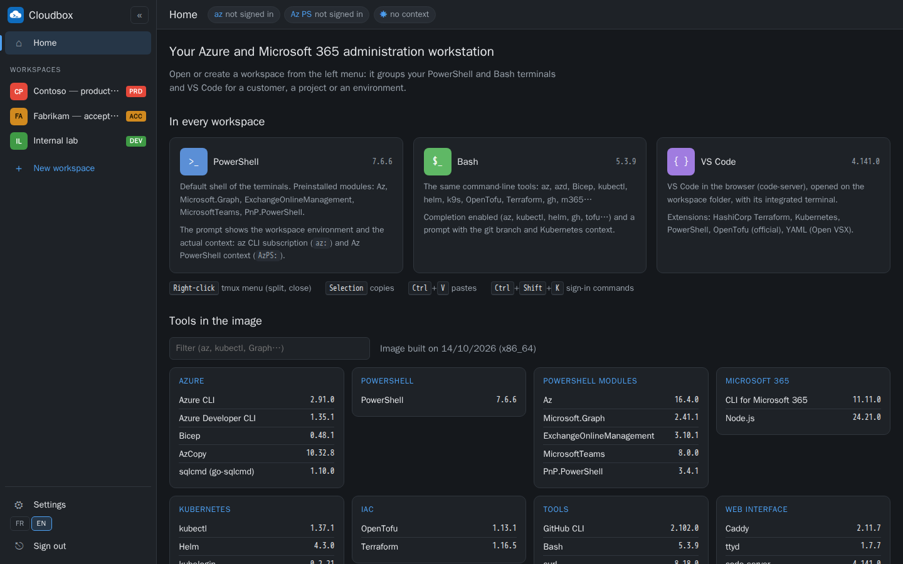

# Cloudbox

A **local Cloud Shell for Azure and Microsoft 365**: a Docker container that runs on your own PC
and is used from the browser, with a web terminal (PowerShell and Bash), VS Code in the browser
and every Azure / Microsoft 365 administration tool, kept up to date.

> **Status: step 2 (workspaces).** The `:cli` and `:web` images build and pass their tests
> (HTTP and browser). The technical framing and the roadmap are in [`CLAUDE.md`](CLAUDE.md)
> (in French).


## Screenshots

| | |
|---|---|
|  |  |
| **Home**: the three tools of every workspace, terminal tips and the version of each tool in the image. | **Connections**: device-code sign-in commands completed with the workspace settings, typed into a terminal without being run. |
|  |  |
| **Workspace settings**: name, environment (DEV / ACC / PRD), tenant, subscription, SharePoint URL, ClientId. | **Dark theme**, following the system setting. The interface is available in English and French. |

The screenshots are produced by [`docs/screenshots/capture.sh`](docs/screenshots/capture.sh)
(headless Chromium on a throwaway container with sample workspaces).

## How it works

```
browser ──http://localhost:8080──▶ cloudbox container
                                     Caddy (token, Host/Origin checks)
                                     ├── /           portal and workspaces
                                     ├── /api/       cloudbox-api (workspaces, context)
                                     ├── /term/pwsh/ PowerShell terminal (ttyd + tmux)
                                     ├── /term/bash/ Bash terminal (ttyd + tmux)
                                     └── /code/      VS Code in the browser (code-server)
                                    /home/dev = persistent volume (sign-ins, keys, repos)
```

- **One container per person, on their own PC** (Docker Desktop, Podman or wslc).
  No central server.
- Reachable **from the PC only** (`127.0.0.1`), protected by a token.
- Classic terminal access still works: `docker exec -it cloudbox pwsh`.

## Getting started

```bash
docker compose up -d
docker compose exec cloudbox cat /home/dev/.cloudbox/token     # token generated on first start
```

Open http://localhost:8080 and paste the token. It is also shown in `docker compose logs
cloudbox`, kept in the volume (`~/.cloudbox/token`) and stays the same across restarts.

Settings (`.env` file next to `compose.yaml`, ignored by git; template: `.env.example`):

| Variable | Default | Purpose |
|---|---|---|
| `CLOUDBOX_IMAGE` | `ghcr.io/ictdevops/cloudbox:web` | Image to run (`cloudbox:web` for a local build) |
| `CLOUDBOX_PORT` | `8080` | Local port, always published on `127.0.0.1` |
| `CLOUDBOX_TOKEN` | generated | Fixed token (16 characters minimum) |
| `CLOUDBOX_SUDO` | `false` | `true` to allow `sudo` in the container |
| `CLOUDBOX_SHELL` | `pwsh` | Default shell: `cloudbox-shell`, VS Code integrated terminal |
| `CLOUDBOX_MODE` | `web` | `shell`: no web service, for wslc or `docker exec` |
| `TZ` | `Europe/Paris` | Time zone |

Terminal without a browser: `docker exec -it cloudbox pwsh`, `docker exec -it cloudbox bash` or
`docker exec -it cloudbox cloudbox-shell` (shell chosen by `CLOUDBOX_SHELL`). The tmux sessions
of the web terminal can be attached with `tmux attach -t pwsh` or `tmux attach -t bash`.

In the web terminal, the mouse drives tmux: right-click opens the pane menu (split, close…; the
menu stays open until you click), the wheel scrolls the history. **Copy**: select with the mouse
(or double-click a word); the text goes to the PC clipboard ("Copied" is shown). **Paste**:
Ctrl+V, or Shift + right-click for the browser menu. Ctrl+V is therefore no longer sent to the
terminal (in vim, block mode is still available with Ctrl+Q). After a restart or an update of the
container, open terminals reconnect on their own as soon as the server answers (the tmux session
is still there if the container was not recreated).

### Building the images locally

```bash
docker build -t cloudbox:cli -f image/cli/Dockerfile image/cli
docker build -t cloudbox:web -f image/web/Dockerfile --build-arg BASE_IMAGE=cloudbox:cli .
tests/smoke-cli.sh cloudbox:cli
tests/smoke-web.sh cloudbox:web
tests/smoke-browser.sh cloudbox:web     # headless Chromium (Playwright), screenshots in tests/browser-out/
CLOUDBOX_IMAGE=cloudbox:web docker compose up -d
```

## Language

The interface is available in English and French: **FR / EN** buttons at the bottom of the
sidebar and on the sign-in page. The choice is remembered by the browser; otherwise the browser
language applies. API error messages follow the chosen language. VS Code (code-server), the tmux
menu and the tools themselves stay in English whatever the choice.

## Home page

The home page presents the three tools of every workspace (PowerShell, Bash, VS Code), useful
terminal gestures and the version of each tool in the image, by category and with a filter
(VS Code extensions included). Workspaces are created and opened from the sidebar. On first
start, the VS Code panel shows "VS Code is starting…" and reloads on its own while code-server
installs its extensions.

## Workspaces

A workspace groups, for a customer, a project or an environment, PowerShell and Bash terminals
and VS Code in a panel layout (resizable, rearranged by drag and drop).

- A sidebar, always visible, lists the workspaces (coloured by environment) and creates new
  ones: name, ID, **DEV / ACC / PRD** environment, working folder (by default
  `/home/dev/workspaces/<id>`). It collapses to a column of icons.
- Switching between workspaces reloads nothing: the last four opened stay loaded (terminals and
  VS Code), marked by a blue dot in the sidebar.
- The layout is saved automatically in the volume (`~/.cloudbox/workspaces/<id>.json`) and
  restored at the next visit.
- Each terminal panel has its own tmux session, `<id>_<shell>_<n>`: reloading the page, closing
  the browser tab or moving a panel does not stop it. Only the cross on a tab (with confirmation)
  closes the session. Deleting a workspace (⚙ Settings) closes its sessions but **keeps its
  folder**.
- **Settings** (⚙ button): name, environment and the workspace sign-in values (tenant,
  subscription, SharePoint URL, ClientId of the Entra application used by PnP and CLI for
  Microsoft 365).
- **Connections** (button on the right of the toolbar, or Ctrl+Shift+K, including from a
  terminal): panel of sign-in commands, completed with the workspace settings. Each command can
  be copied, or typed with one click into the last terminal used (a PowerShell terminal for
  cmdlets), **without being run**: review it, then press Enter. The actual state is shown when
  the portal can read it (az CLI, Az PowerShell, kubectl, gh), with a warning when az is signed in
  to another tenant or subscription than the workspace ones; Graph, Exchange, Teams and PnP depend
  on each PowerShell session and are not visible.
- A PRD workspace is framed in red, and the prompt of its shells carries a `PRD <id>` badge.
- The displayed context (az CLI subscription, Az PowerShell context, Kubernetes cluster) is read
  from the actual configuration files, never declared. The shell prompt also shows the az CLI
  subscription (`az:`) and, in PowerShell, the Az context (`AzPS:`) once the `Az.Accounts`
  module is loaded: these are two separate contexts.

> **Current limitation:** sign-ins (az, Az PowerShell, kubectl…) are still **shared by all
> workspaces**, which the portal points out ("shared across workspaces"). Per-workspace identity
> isolation is step 3 of the roadmap.

## Signing in to the services (device code)

In a workspace, the **Connections** panel provides these commands already completed (tenant,
subscription, SharePoint URL, ClientId).

| Service | Command |
|---|---|
| Azure CLI | `az login --use-device-code` |
| Az PowerShell | `Connect-AzAccount -UseDeviceAuthentication` |
| Microsoft Graph | `Connect-MgGraph -UseDeviceCode` |
| Exchange Online | `Connect-ExchangeOnline -Device` |
| Microsoft Teams | `Connect-MicrosoftTeams -UseDeviceAuthentication` |
| PnP PowerShell | `Connect-PnPOnline -Url … -DeviceLogin -ClientId <app-id>` |
| CLI for Microsoft 365 | `m365 login --authType deviceCode` |

Token caches live in `/home/dev` (volume): they survive the recreation of the container.

## Tools

| Area | Tools |
| --- | --- |
| Azure | Azure CLI, Azure Developer CLI, Bicep, AzCopy, sqlcmd (go-sqlcmd) |
| PowerShell | PowerShell 7 + Az, Microsoft.Graph, ExchangeOnlineManagement, MicrosoftTeams, PnP.PowerShell modules |
| Microsoft 365 | CLI for Microsoft 365 (Node.js LTS) |
| Kubernetes | kubectl, helm, kubelogin, k9s, kubectx / kubens |
| IaC | OpenTofu, Terraform |
| Tools | gh, git, curl, jq, yq, openssl, tmux, fzf, ripgrep, bat, network tools… |
| Web interface | Caddy, ttyd + tmux, code-server, s6-overlay; portal in TypeScript + Vite + Preact + Dockview |

`cloudbox-versions` shows the installed versions (tools, PowerShell modules, VS Code
extensions); the portal home page and every GitHub release (`versions.json`) use this list.

Preinstalled VS Code extensions (Open VSX): PowerShell, HashiCorp Terraform, OpenTofu, YAML,
Kubernetes. **The Bicep extension (`ms-azuretools.vscode-bicep`) is not published on Open VSX**:
it is not installed. VS Code AI features (Chat, Copilot) are disabled by default.

**Terraform** is distributed under the BSL 1.1 (Business Source License): using it to manage your
own infrastructure is allowed. OpenTofu (MPL 2.0) is installed alongside.

## Security

- Port published on `127.0.0.1` only; Caddy is the only TCP listener in the container, ttyd,
  code-server and cloudbox-api use UNIX sockets.
- Mandatory authentication: the token is exchanged for an `HttpOnly`, `SameSite=Strict` session
  cookie, or sent as an `Authorization: Bearer <token>` header (scripts). Without a session: 401.
- `Host` header restricted to `localhost` / `127.0.0.1` (DNS rebinding); `Origin` checked, and
  required for WebSockets (CSRF).
- Security headers: `X-Frame-Options`, per-route `Content-Security-Policy`,
  `Referrer-Policy: no-referrer`, `X-Content-Type-Options: nosniff`.
- API writes are JSON only (no cross-origin "simple" request); workspace sign-in values follow
  strict character sets, and text typed into a terminal by the portal rejects any control
  character: it is never run without the user pressing Enter.
- Non-root `dev` user (uid 1000), including for s6-overlay and the services. `sudo` is disabled
  by default; `CLOUDBOX_SUDO=true` can only be set when the container is created (the variable is
  read from the environment of PID 1).
- No Docker socket mounted, no `--privileged`. CLI telemetry disabled.

## Images and updates

| Tag | Content |
|---|---|
| `:web`, `:latest` | Full image (weekly build) |
| `:cli` | Tools only, without the web interface (wslc / `docker exec`) |
| `:vYYYY.MM.DD-web`, `:vYYYY.MM.DD-cli` | Dated weekly build |
| `:edge` | Latest commit on `main` |
| `:sha-<commit>-web`, `:sha-<commit>-cli` | Build of a given commit |

Every tool is pinned (`ARG <TOOL>_VERSION` + `# renovate:` comment). Renovate opens one PR per
tool after 3 days of availability; the workflow builds the amd64 image and runs the smoke tests;
patch/minor updates are merged automatically when everything is green, major ones wait for a
review. Automatic merging requires the protection of `main` to require the `build` workflow
status.

## Origin

Inspired by [WSLC](https://github.com/CTroessaert/WSLC) (CTroessaert), a `wslc` container for
Azure / Microsoft 365 administration. Cloudbox takes over its principles (pinned versions,
Renovate, persistent home) and adds the web interface. No WSLC code is reused.
